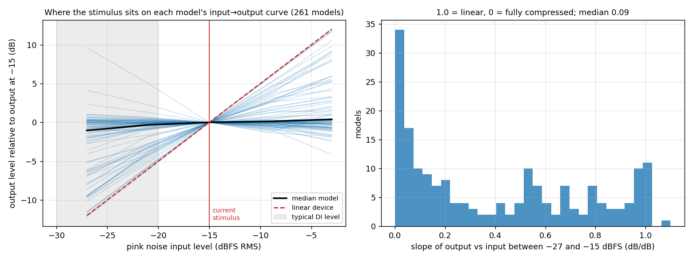
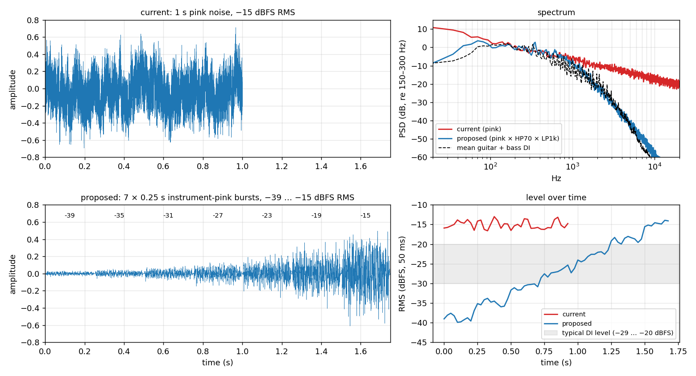
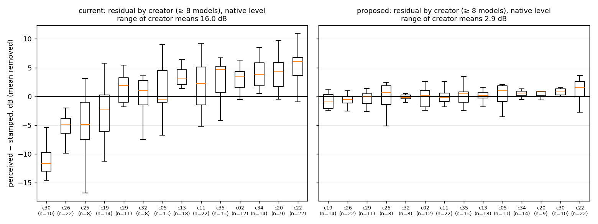
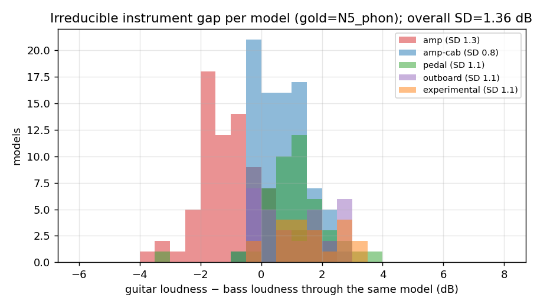
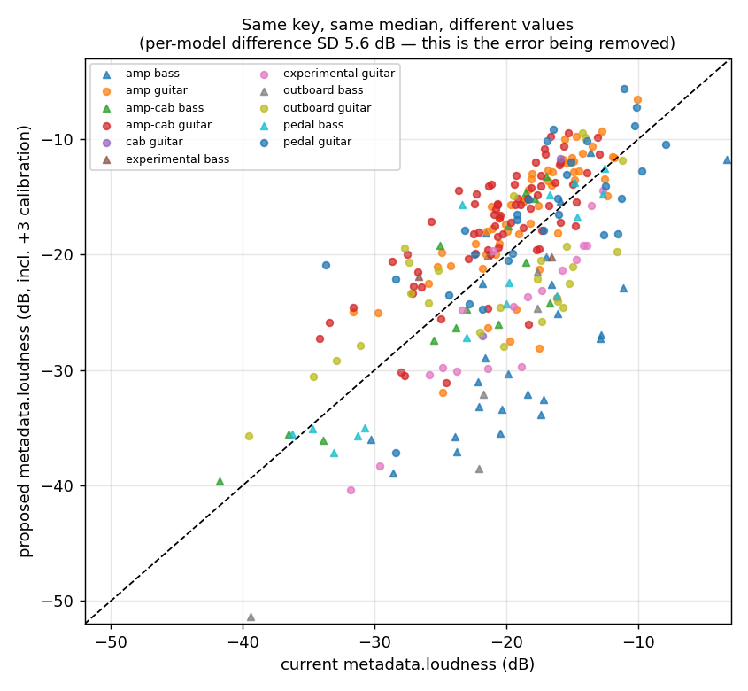

# Making `metadata.loudness` actually level models

*A research study of the loudness number the [NAM trainer](https://github.com/sdatkinson/neural-amp-modeler)
stamps into every `.nam` file, why switching models still produces big
volume jumps, and a drop-in replacement for the calculation that removes
most of the problem for guitar and bass across every kind of gear. By
[TONE3000](https://www.tone3000.com), October 2026, in support of an
upcoming pull request to the trainer.*

**Hear it:** open [`listening_test/index.html`](listening_test/index.html)
in a browser — real guitar and bass through 18 models, switch presets under
the current and the proposed normalisation (§7.7).

---

**Contents**

1. [The problem](#1-the-problem)
2. [How the number is computed and used today](#2-how-the-number-is-computed-and-used-today)
3. [How we measured "better"](#3-how-we-measured-better)
4. [What is wrong with the current calculation](#4-what-is-wrong-with-the-current-calculation)
5. [What a good calculation looks like](#5-what-a-good-calculation-looks-like)
6. [The proposed calculation](#6-the-proposed-calculation)
7. [Results](#7-results)
8. [Backward compatibility and migration](#8-backward-compatibility-and-migration)
9. [What a single number cannot fix](#9-what-a-single-number-cannot-fix)
10. [Limitations](#10-limitations)
11. [Repository layout and reproduction](#11-repository-layout-and-reproduction)

---

## 1. The problem

Every `.nam` file carries `metadata.loudness`, a dB figure that engines use
to turn models up or down so that switching between them keeps a steady
listening volume: `gain = −18 − loudness`. Users of the TONE3000 plugin,
pedal and web player report that it does not work well — some models are
much louder than others after normalisation, bass models in particular come
out quiet, and a few models are left un-normalised because the required
gain exceeds the engines' ±12 dB clamp.

We measured it. On 261 public TONE3000 models of every gear type, after
normalising with today's number, two random models still differ by
**18 dB at the 5–95 % range** (SD ≈ 5.8 dB), and the errors are systematic:

| group (native playing level) | mean error today |
|---|---|
| bass amp captures | −8.0 dB |
| bass preamps / outboard | −10.0 dB |
| guitar amp + cab captures | +3.7 dB |
| "experimental" | −5.5 dB |
| one creator's models (n = 10) | −11.1 dB |
| another creator's models (n = 22) | +4.9 dB |

The brief for the study: find **one calculation** — a fixed stimulus and a
fixed measurement that knows nothing about gear type, instrument or creator
— that makes "switch model → same volume" hold for both guitar and bass
through every model, **without assuming how hard the player hits the
model** (people run models from cold passive pickups to hot active basses
through interfaces with the gain set anywhere), keeping the stimulus a
**short noise** like the current one and improving `metadata.loudness` **in
place** rather than inventing a new key.

## 2. How the number is computed and used today

**Trainer** (`nam/models/base.py`, `BaseNet._metadata_loudness`): render a
fixed 1 s file of pink noise (`nam/models/_resources/loudness_input.wav`,
−14.97 dBFS RMS, peak −2.95 dBFS, with a −28 dBFS DC offset) through the
model and take the flat RMS of the output in dB. A2 containers copy the
value from their highest-quality submodel; the output-scale hook shifts it
by `20·log10(scale)`.

**Engines** — all do `gain = target − loudness`:

| engine | target | clamp | sanity window |
|---|---|---|---|
| TONE3000 plugin (`Processor.cpp`) | −18 dB, user-adjustable | ±12 dB | finite, −100 < L ≤ 0 |
| TONE3000 pedal (`t3k_pedal.cpp`, `.namb` header f64) | −18 | ±12 | same |
| TONE3000 web player (`nam-engine.cpp`) | −18 | ±12 | same |
| upstream NeuralAmpModelerPlugin | −18 | none | — |

Details, including the GitHub history of the feature and the issue (#588)
proposing a high-passed stimulus: `docs/01_problem_statement.md`,
`docs/02_prior_art.md`, `docs/04_engine_side.md`.

## 3. How we measured "better"

A loudness number `L(m)` is good exactly when, for the signals people play,
the perceived level *after normalisation* is the same for every model.
Writing `G(m, s)` for the perceived loudness of model `m` driven by signal
`s`, the error between any two models is the difference of their residuals
`r(m) = G(m, s) − L(m)`, so the quality of a candidate calculation is the
**spread (SD) of `r` across models**. The mean of `r` is irrelevant — it is
absorbed by the engine's target.

**Models.** A stratified sample of **261 public TONE3000 models** from the
full catalogue (80 053 A2 models, 35 creators — one creator owns 55.7 % of
it), one per tone, capped at 22 per creator (top creator 8.4 %, 32
creators), covering amp, amp-cab, pedal, outboard, experimental and cab,
23 % bass (`results/corpus_audit.md`). Models and creators appear in this
repository only under anonymised ids (`m001` …, `c01` …). An earlier
diagnostic pass on a separate 270-model sample reproduced the headline
numbers.

**Candidates.** 1 048 fixed stimulus × measure combinations per model:
7 noise spectra × {steady, plucked, level-sweep burst train} envelopes ×
stimulus levels from −39 to −12 dBFS × {flat, 80 Hz high-pass, K-weighted,
A-weighted} measures, plus the shipped calculation as baseline. (The
diagnostic pass also tried real-instrument mixes, band-pass "virtual cab"
measures and psychoacoustic measures as *candidates*; none beat shaped
noise with a K-weighted measure and they are not part of the final
evaluation.)

**Gold — what the listener hears.** 15 real DI clips (10 guitar, 5 bass;
clean, rhythm, metal, jazz, fingerstyle and slap bass …) played through
every model at **five player levels**: −12, −6, 0, +6, +12 dB around the
demo DIs, i.e. −40 … −16 dBFS RMS. Amp-only models are additionally heard
through real guitar and bass cabinet IRs with the engines' IR gain
convention. Perceived loudness is scored with ISO 532-1 Zwicker time-varying
loudness (the psychoacoustic reference) and BS.1770 LUFS, and every model is
scored on *both* instruments with equal weight. 98 955 gold measurements.

**Score.** For each candidate: SD of the residual at each player level,
averaged over the five levels (`sd_uniform` — the headline, "we don't know
how hard they play"), at the worst level (`sd_max`), and at the demo-DI
level (`sd_native`); plus 5–95 % range, offsets by gear × instrument,
creator and training type, and engine clamp exposure. Because the error is
scored over a *uniform prior on the player's level*, we can also compute the
best any scalar could possibly do (§5).

Scripts: `scripts/run_experiment.py`, `scripts/analyze.py`; method in
full: `docs/03_method_and_results.md` §2.

## 4. What is wrong with the current calculation

### 4.1 It measures models at a level nobody plays at

The pink noise is at −15 dBFS RMS. Real signals are much quieter: the demo
DIs are −28 dBFS RMS (−25 … −30 over their loudest 6 s), the NAM v3
training signal −22, and with the catalogue's median `input_level_dbu` of
19 a passive guitar sits at ≈ −29 dBFS RMS and a hot active bass at ≈ −20.

At −15 dBFS, three quarters of models are in hard compression. The number
therefore measures each model's *ceiling* — which is about the same for
every driven amp — instead of its level where it is played. Linear or
lightly driven models (clean amps, bass preamps, EQs, most pedals) are
measured ≈ 10 dB above where they will be played and get turned down.



*Left: each line is one model's output level vs pink-noise input level,
relative to its output at −15. The median model (black) gains 0.7 dB over
the 12 dB from −27 to −15; a linear device (red dashed) would gain 12. Right:
the distribution of that slope — a third of models are essentially flat.*

The consequence is visible when the error is plotted against how hard the
player hits the model: the current number is accurate only for players at
≈ −16 dBFS RMS and degrades at ≈ 0.4 dB of SD per dB below that.


### 4.2 Pink noise has the wrong spectrum — the top, not the bottom

Issue #588 proposed high-passing the stimulus because pink noise has a lot
of energy below 80 Hz that guitars do not. In the data, the high-pass alone
makes things slightly *worse* than plain pink at every level (+0.2 dB). The
problem is the other end: pink noise has −3 dB/oct above 1 kHz where real
guitar and bass DIs fall at −12 dB/oct, so pink drives the presence and
treble regions of every model in a way no instrument does. A 2nd-order
low-pass near 1 kHz (plus a 70 Hz high-pass) is worth 1.0–1.5 dB; matching
the measured DI spectrum exactly gains nothing further.



### 4.3 Flat RMS is the least perceptual measure

K-weighting (the BS.1770 pre-filter used by LUFS) tracks perceived loudness
better than flat RMS (0.05–0.3 dB depending on the gold), and it is the
only measure that places amp-only models correctly once a cab is on them
(§7.4). A-weighting is better under one gold and 0.9 dB worse under
another; band-pass "virtual cab" measures never help.

### 4.4 Things that are *not* the problem

DC offset in the stimulus (< 0.1 dB), the 1 s length and model settling
(< 0.2 dB), the envelope (steady vs plucked, < 0.1 dB). They were measured
on all models (`results/side_experiments.csv`, `results/length_test.csv`)
and can be cleaned up for free, but they explain none of the complaint.

## 5. What a good calculation looks like

**Level comes first, by a wide margin.** Moving the shipped pink noise from
−15 to −27 dBFS, changing nothing else, takes the level-averaged SD from
6.3 to 4.3 dB. The curves for every spectral shape bottom out at −30 … −27
dBFS and rise steeply above −21:


*Each curve: one noise shape, K-weighted measure, steady (left) or plucked
(right) envelope, as a function of stimulus level; y = SD of the residual
averaged over player levels ±12 dB. Dashed: the current calculation.*

**But picking a level means guessing where users play.** The study scores
under a uniform prior on the player's level, and under that prior there is
a clean answer to "what is the best possible scalar": the one that
minimises the summed squared residual over levels is

\[
L^*(m) = \operatorname{mean}_{\text{levels}}\; G_{\text{level}}(m)
\]

— the **average, in dB, of the model's output level across input levels**.
Nothing a single number can do beats it; on this corpus it gives
`sd_uniform` 2.6 dB (LUFS) / 2.8 dB (Zwicker) — the dashed lower bound in
the figure in §4.1.

A stimulus that approximates `L*` and stays a short noise is a **burst
train**: the same noise at several levels spanning the range users play
at, measured per burst, averaged in dB. Averaging in *energy* instead would
be dominated by the loudest burst and collapse back to a single-level
measurement (confirmed: energy pooling is 1 dB worse than mean-of-dB and
no better than one hot level). Multi-level averaging buys 0.1–0.15 dB over
the best single level — modest — but it replaces a tuned constant ("−27")
with a design statement ("the levels players use"), and it is already at
the optimum for whatever centre the range has.

## 6. The proposed calculation

Replace the stimulus file and the measure behind `metadata.loudness`. Same
key, same units, same sign convention, same catalogue median.

```
stimulus  s : 7 bursts × 0.25 s (1.75 s total, 48 kHz mono) of
              pink noise × 2nd-order HP 70 Hz × 2nd-order LP 1 kHz,
              burst RMS −39, −35, −31, −27, −23, −19, −15 dBFS,
              10 ms raised-cosine edges            → results/stimulus/loudness_input_proposed.wav

y           = K( model(s) )                        ITU-R BS.1770-4 K pre-filter (48 kHz), applied once
Lb          = −0.691 + 10·log10( mean(y_b²) )      level of burst b, 30 ms trimmed at each edge
loudness    = 3.0 + mean_b(Lb)                     [dB]
```

* **Why this noise.** Pink with the extremes a guitar or bass never produces
  removed. `ip1k` is within 0.05 dB of the non-parametric "shaped to the
  measured DI spectrum" noise and is the only shape in the top group under
  every gold (a 500 Hz corner over-corrects under the perceptual gold, 2 kHz
  under-corrects under LUFS). Fully deterministic from one seed; nothing
  derived from recordings.
* **Why these levels.** −39 … −15 covers a passive single-coil at low
  interface gain through an active bass at high gain, centred on −27 where
  every single-level curve bottoms out. A wider range (−45 … −9) scores
  within 0.01 dB; a range centred 3 dB higher is ≈ 1 dB worse at the worst
  player level. The centre matters; the width barely does.
* **Why K and mean-of-dB.** §4.3 and §5.
* **Why +3.0.** It is `median(old) − median(new)` on the corpus (3.07), so
  the median model stamps the same value and gets the same gain from the
  engines' −18 dB target as today.
* **Why 0.25 s bursts are enough.** The K level of a 0.5 s render differs
  from a 4 s render by 0.15 dB SD across models, and the burst train matches
  the idealised average of ten 1 s renders to 0.02 dB of score.
* **Properties preserved.** Shift-equivariant under output gain, so the
  output-scale hook and A2-container logic are unchanged; strictly negative
  and finite for every model in both corpora, so it passes the engines'
  sanity window. Cost ≈ 0.3 s per model on CPU; the C++ core's
  `a2_fast_path` reproduces PyTorch to 0.0000 dB (`results/parity_cpp.csv`).

`scripts/reference_impl.py` is a self-contained implementation
(K coefficients included) that reproduces the experiment's values to
< 0.02 dB.

## 7. Results

### 7.1 Headline

261 models, all gear types, guitar and bass, five player levels.

| | current | **proposed** | best possible scalar |
|---|---|---|---|
| SD of residual at the demo-DI level — Zwicker / LUFS | 5.8 / 5.5 | **1.6 / 1.4** | ≈ 0.6 |
| SD averaged over player level ±12 dB — Zwicker / LUFS | 6.1 / 5.7 | **3.4 / 3.0** | 2.8 / 2.6 |
| SD at the worst player level | 9.7 | 4.7 | ≈ 4.0 |
| 5–95 % range of the residual | 18.3 dB | **5.1 dB** | |
| range of gear-group mean offsets | 7.9 dB | 1.6 dB | |
| bass-model − guitar-model offset | −5.7 dB | +0.1 dB | |
| range of per-creator means (≥ 8 models) | 16 dB | 2.9 dB | |
| rank among 1 048 candidates | 1007 | 5th on consensus, within 0.03 dB of #1 | |

### 7.2 By gear type and instrument


*Residual after normalisation, pooled over all five player levels, by gear
× instrument. Left: today. Right: proposed. No gear type or instrument is
special-cased anywhere in the calculation.*

Native-level group means, current → proposed (Zwicker): amp-bass −8.0 →
+0.2; amp-guitar +1.8 → 0.0; amp-cab-bass −0.5 → −0.6; amp-cab-guitar +3.7
→ +0.3; experimental-guitar −5.5 → −0.5; outboard-bass −10.0 → −0.4;
outboard-guitar +0.3 → +1.0; pedal-bass −1.5 → −0.1; pedal-guitar +0.4 →
−0.9. Within-group SDs fall from 3.5–7 dB to 1–2 dB.

### 7.3 By creator and training type



Today the number encodes "who made it" almost as much as "how loud it is":
one creator's models are 11 dB quiet on average, another's 5 dB loud, and
the three training pipelines (dry-wet / sweep-v3 / convert) differ by
3.4 dB. With the proposed calculation creator means span 2.9 dB and training
types are within 0.4 dB.

### 7.4 Amp-only models and cabinets


Putting a real cabinet IR (unity in-band gain, as the pedal and web player
do) after an amp-only model lowers its perceived loudness by ≈ 1.4 phon
(SD 0.8) while leaving its LUFS within a fraction of a dB — the cab removes fizz the ear counts
as loud. The K-weighted calculation already places amp-only models level
with everything else *once the cab is on*; heard raw they are ≈ 1.5 dB
louder, which is correct (they are fizzier raw). No cab-anticipating band
limit is needed.

### 7.5 Guitar vs bass through the same model



Through one and the same model, guitar and bass material differ in
perceived loudness by a model-dependent amount with SD ≈ 1.4 dB. That is
the floor for any single number that must serve both instruments — and the
proposed calculation is close to it (1.6 dB native SD).

### 7.6 Old vs new values



The two numbers are not inter-convertible — their per-model difference has
SD 5.6 dB, and that difference *is* the error being removed. The new value
spreads wider (−51 … −6 dB vs −42 … −3) because the current one compresses
the catalogue by measuring ceilings.

### 7.7 Hear it

`listening_test/index.html` (built by `scripts/listening_test.py`; open the
file directly or serve the folder statically) plays five real DI clips — clean, rhythm
and lead guitar, two basses — through 18 models spanning every gear type,
at three player levels. Choose *current*, *proposed* or *no* normalisation
and step through the models while the clip keeps playing (arrow keys, or
auto-scan every N seconds); the clip position carries over, so the only
thing that changes is the preset-to-preset volume jump. Each row shows the
measured level you are hearing under all three schemes, with the spread
across models for the selected one at the top. Amp-only models go through
a cabinet IR; gains are the raw engine arithmetic, `−18 − loudness`, with
no clamp.

## 8. Backward compatibility and migration

**Engines need no change to benefit.** Same key, same `target − loudness`
arithmetic, same −18 dB target, same median.

**Recommended engine changes.**

* **Widen the clamp to ±18 dB** (or asymmetric −18/+15: boost is what
  exposes noise floors; cut is harmless). With the new value and the −18
  target, 13.4 % of corpus models exceed ±12 dB — all on the boost side
  (quiet clean amps, attenuated or DI-level captures) — vs 8.0 % today;
  8.4 % exceed ±15, 4.2 % exceed ±18. Nothing would be pushed above
  −5.7 dB.
* **Use the trainer `version`** already in every `.nam` header to tell
  old stamps from new during the transition (flag, or re-stamp on import).
  An old stamp is 5.6 dB SD away from the new one per model — exactly
  today's error — so a mixed catalogue is no worse than today for old
  models and fixed for new ones. The pedal's `.namb` header and the
  web player / plugin loaders need no new fields.
* Independently of the metadata: align the plugin's IR gain convention
  (unit energy − 18 dB pad, ≈ 11 dB under unity in-band) with the pedal and
  web player's unity in-band convention so NAM-only and NAM→IR presets sit
  at the same level everywhere.

**Steps.**

1. Trainer release: new `loudness_input.wav` (1.75 s burst train), new
   `_metadata_loudness` (K, per burst, mean of dB, +3), version bump,
   docstring and metadata-doc update.
2. TONE3000: re-stamp the catalogue with the reference calculation on each
   highest-quality submodel (≈ 0.3 s/model; either PyTorch or the C++ core).
   Validate on a fresh sample with `scripts/run_experiment.py` /
   `aggregate.py` / `analyze.py` (expect §7.1 within ≈ 0.2 dB).
3. Engines: widen the clamp; optionally flag pre-version stamps until the
   backfill lands; upstream plugin PR for the same.

## 9. What a single number cannot fix

After the proposed calculation the remaining error is 1.4–1.6 dB SD for
players at any *one* level, rising to ≈ 4.5 dB for players 12 dB above or
below the centre of the burst range. That rise is each model's own
level-dependence (compression) seen from a level other than the player's;
no scalar can remove it, and the proposed one is within 0.4–1 dB of the
theoretical bound at every level.

The seven per-burst levels are, however, a complete picture of the model's
input-level → output-level curve. If they were stored as well
(`loudness_curve`, 7 floats) and an engine estimated the player's input
level with a slow follower and interpolated, the error would stay at
≈ 1.5–2 dB SD at *every* player level (`results/curve_*.csv`). That is
a possible later step and does not affect the in-place recommendation.

## 10. Limitations

* The gold is a *model* of perception (ISO 532-1, BS.1770), not a listening
  test. All golds agree on the ordering, but the 1.6 dB floor and the K-vs-
  flat margin would benefit from a small AB test.
* The player-level prior is uniform over ±12 dB around the demo DIs. If
  plugin telemetry shows users cluster elsewhere, shift the burst range's
  centre (a one-constant change); the width is insensitive.
* 15 evaluation clips, 3 cabinet IRs, A2 models only; stereo / multi-channel
  and `Sequential` chains were not covered. The catalogue has six `cab`
  models; two are in the corpus.
* An earlier diagnostic pass of the study proposed a 6 s real-instrument
  stimulus at one assumed level under a new key. Under the level-agnostic
  criterion its synthetic equivalent scores 0.17 dB worse than the burst
  train with a 1 dB worse worst case, real-instrument material and length
  buy nothing over shaped noise, and a new key is unnecessary once the
  value is calibrated to today's median — so that direction was dropped.
* The listening test is a demonstration, not a controlled listening
  experiment.

## 11. Repository layout and reproduction

```
loudness-research/
├── README.md                     this document
├── docs/
│   ├── 01_problem_statement.md   current implementation, stimulus analysis, engine usage, the complaint
│   ├── 02_prior_art.md           GitHub history (trainer / Core / Plugin), standards, perception literature
│   ├── 03_method_and_results.md  corpus, candidates, gold, scoring, full results, recommendation, migration
│   └── 04_engine_side.md         target, clamp, IR gain conventions, calibration, runtime options
├── scripts/
│   ├── common.py                 paths, model loading (A2 containers → highest-quality submodel), rendering
│   ├── measures.py               RMS / HP / A / K / LUFS / ISO 532-1 / IR in-band gain
│   ├── stimuli.py                gold DI clips, IRs, shared signal helpers
│   ├── candidates.py             deterministic noise stimuli (shapes × envelopes × level sweeps)
│   ├── fetch_catalog.py          pull the catalogue (internal endpoint; needs T3K_CATALOG_API / _CODE)
│   ├── select_corpus.py          stratified, creator-capped corpus from the catalogue
│   ├── anonymize.py              private ids → m###/c## (mapping stays in data/private/, git-ignored)
│   ├── download_models.py        fetch the .nam files (needs the private mapping)
│   ├── corpus_audit.py           catalogue vs corpus: gear / training-type / creator shares
│   ├── run_experiment.py         candidates + gold through every model → results/raw/ (git-ignored)
│   ├── aggregate.py              results/raw/ → the committed tables in results/*.csv.gz
│   ├── analyze.py                rankings, oracle bound, curve simulation, migration, figures
│   ├── side_experiments.py       operating point, DC offset, settling
│   ├── parity_cpp.py             PyTorch vs C++ core parity
│   ├── reference_impl.py         self-contained implementation of the proposed calculation
│   ├── readme_figures.py         the readme_*.png figures used above
│   └── listening_test.py         renders the clips and builds listening_test/
├── listening_test/
│   ├── index.html, data.json     open in a browser (§7.7)
│   └── audio/                    270 MP3 renders (17 MB)
├── data/
│   ├── corpus.csv                the 261 models: anon id, gear, instrument, training type, input level, creator
│   ├── audio/inputs, audio/irs   guitar and bass DIs, cabinet IRs (see data/audio/README.md)
│   ├── stimulus/                 the shipped loudness_input_current.wav
│   └── models/, private/         git-ignored: .nam files, catalogue, id mapping
└── results/
    ├── models.csv, candidates.csv.gz, bursts.csv.gz, gold.csv.gz   aggregated per-model measurements
    ├── ranking_*.csv, ranking_consensus.csv     every candidate under each gold
    ├── migration.csv, migration_summary.json    old vs new value per model, calibration, clamp
    ├── curve_*.csv, length_test.csv             beyond-a-scalar simulation, stimulus length
    ├── side_experiments.csv, parity_cpp.csv, corpus_audit.md, analyze_output.txt
    ├── stimulus/loudness_input_proposed.wav     the proposed stimulus
    ├── figures/*.png
    └── raw/                                     git-ignored per-model results
```

Reproducing the analysis needs no models — the aggregated measurements are
committed:

```
pip install -r requirements.txt
python scripts/analyze.py              # rankings, migration, figures → results/
python scripts/reference_impl.py --write-stimulus --check
python scripts/readme_figures.py
```

Re-running the experiment itself (≈ 75 min with 9 workers) needs the `.nam`
files, which are not distributed here; the models are public TONE3000
captures, but the mapping from anonymised ids back to them is private:

```
python scripts/download_models.py      # needs data/private/mapping_models.csv
python scripts/run_experiment.py --workers 9
python scripts/aggregate.py
python scripts/analyze.py
python scripts/listening_test.py && open listening_test/index.html
```

Everything is deterministic given the corpus and the stimuli. Test material
(guitar and bass DIs, cabinet IRs) is in `data/audio/` with attribution in
`data/audio/README.md`.
