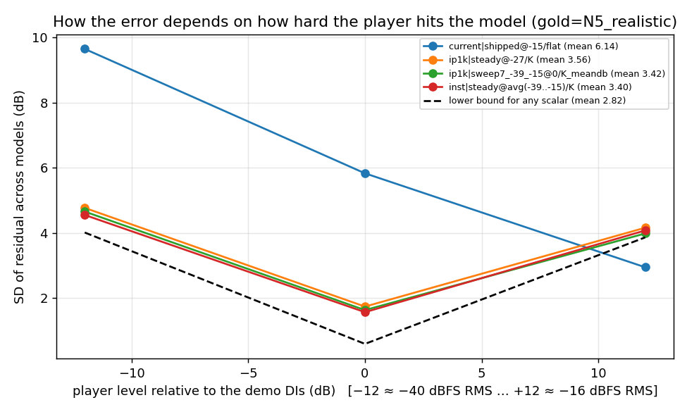
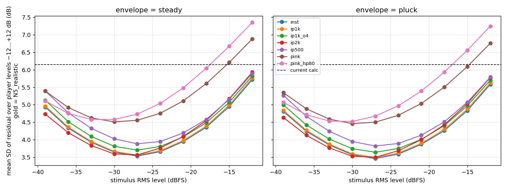
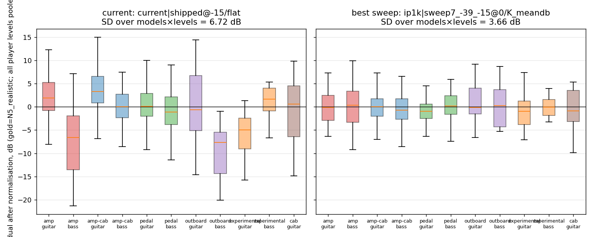
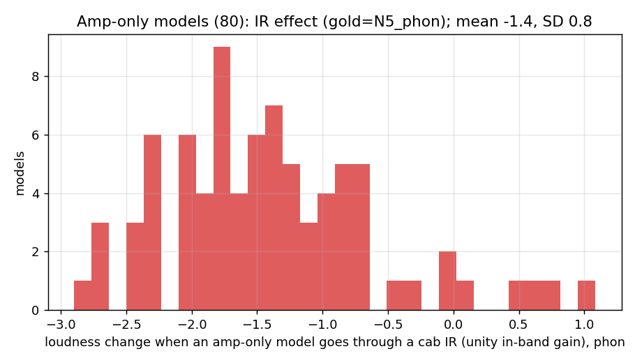

# 03 — Method and results

Scripts: `select_corpus.py`, `corpus_audit.py`, `candidates.py`,
`run_experiment.py`, `aggregate.py`, `analyze.py`, `side_experiments.py`,
`reference_impl.py`, `parity_cpp.py`. Every number below is in `results/`
and can be regenerated from the committed aggregated tables with
`python scripts/analyze.py` (no models needed).

## 1. Corpus (`data/corpus.csv`, `results/corpus_audit.md`)

261 public TONE3000 A2 models, sampled from the full catalogue (80 053
models, 35 creators) with explicit strata and a cap of 22 models per
creator so that no creator can dominate. One model per tone (pack).
Models and creators are referred to by anonymised ids throughout
(`m001` …, `c01` …).

| | catalogue | corpus |
|---|---|---|
| models | 80 053 | 261 |
| creators | 35 | 32 |
| top creator share | 55.7 % | **8.4 %** |
| top-3 creators share | 70.0 % | **25.2 %** |
| amp / amp-cab / pedal / outboard / experimental / cab | 32 / 56 / 5 / 6 / 1 / 0 % | 31 / 32 / 17 / 12 / 8 / 1 % |
| bass share | 2.5 % | 23 % |
| training type dry-wet / sweep-v3 / convert | 71 / 18 / 11 % | 33 / 46 / 22 % |

Gear and instrument are *strata*, deliberately over-sampled relative to the
catalogue so the rare groups (bass, pedal, outboard, experimental) can be
measured at all; statistics are therefore reported per group as well as
pooled. The catalogue has only six `cab` models in total; two are in the
corpus. An earlier diagnostic pass of the study on a separate, differently
sampled 270-model set (25 % one creator) gave the same headline numbers for
the current calculation (SD 5.9 vs 5.8 dB here), so the finding is not a
property of one creator's capture habits.

Does creator matter? Under the current calculation the per-creator mean
residual (creators with ≥ 8 models) spans **16 dB** (SD of creator means
4.6 dB): one creator's models come out 11 dB quiet on average, another's
5 dB loud — today's number encodes "who made it" almost as much as "how
loud it is". With the recommended calculation the same creator means span
2.9 dB (SD 0.7 dB). Training type (dry-wet / sweep-v3 / convert) shows the
same picture: −2.5 … +0.9 dB group means today, −0.1 … +0.2 dB after.

## 2. Method

### 2.1 Framing

The engines apply `gain = TARGET − loudness`. For a listener playing signal
`s` through model `m`, the perceived level after normalisation is
`P(m, s) = G(m, s) − L(m)` plus a constant, where `G` is the perceived
loudness of `m(s)` and `L` the stamped number. Switching between models
sounds consistent exactly when `P` is constant across `m`, so the quality of
a candidate `L` is the **spread (SD) of `G − L` across models** for
realistic `s`. The mean is irrelevant (absorbed into the target).

Hard constraints from the brief:

1. **One calculation for every model.** A candidate `L` is a fixed stimulus
   + a fixed measurement; it may not look at gear type, instrument, tags or
   any metadata other than the model's own input → output behaviour.
2. **Both instruments.** `G` is evaluated with guitar *and* bass material
   for every model and scored on the pooled set.
3. **No assumed player level.** Users hit models anywhere from a cold
   passive pickup to a hot active bass with interface gain set wherever, so
   the spread is scored over a prior on the player's level, not at one
   level.
4. **Short noise, same key.** The stimulus stays a short noise like the
   shipped file and the result is an in-place improvement of
   `metadata.loudness`.

### 2.2 The level problem, stated properly

Let \(G_o(m)\) be the perceived loudness of model \(m\) when the player's
signal is \(o\) dB away from a reference level. The quantity to minimise is
the SD across models of \(r_o(m) = G_o(m) - L(m)\), over a **uniform prior
on \(o \in \{-12, -6, 0, +6, +12\}\) dB** around the demo DIs (−40 … −16
dBFS RMS for 6 s excerpts; the demo DIs are −28 dBFS RMS whole-file,
−25 … −30 over their loudest 6 s). Three numbers per candidate:

* `sd_uniform` — mean over offsets of the SD across models (the headline);
* `sd_max` — the worst offset;
* `sd_native` — offset 0 only.

Two consequences follow.

**Oracle bound.** For a fixed set of offsets the scalar that minimises the
summed squared residual is \(L^*(m) = \text{mean}_o\, G_o(m)\) — the
*average over levels of the output level in dB*. No scalar can beat it. On
this corpus it gives `sd_uniform` = 2.6 (LUFS) / 2.8 dB (Zwicker); the
current calculation sits at 5.7 / 6.1 dB.

**What the stimulus should be.** A scalar that approximates \(L^*\) must
sample the model at several input levels and average the *decibel* output
levels. A stimulus that does this and stays a short noise is a **burst
train**: \(N\) short bursts of the same noise at levels spanning the range
users play at, measured per burst, mean of dB. Averaging in energy would be
dominated by the loudest burst and collapse back to a single-level
measurement (confirmed below).

### 2.3 Candidates (`candidates.py`)

All stimuli are deterministic Gaussian noise (one seed) shaped and
enveloped; nothing is derived from recorded material, so the stimulus can
ship in the trainer as a small wav or be regenerated from its description.

* **Spectral shape** (7): `pink`; `pink_hp80` (issue #588's proposal);
  `ip500` / `ip1k` / `ip2k` = pink × 2nd-order HP 70 Hz × 2nd-order LP at
  500 Hz / 1 kHz / 2 kHz ("instrument pink"; the mean guitar+bass DI
  spectrum is ≈ pink × HP2(70) × LP2(1 kHz), see `readme_stimuli.png`);
  `ip1k_o4` (4th-order LP); `inst` (noise shaped to the measured mean DI
  spectrum, non-parametric reference).
* **Envelope**: `steady` 1 s; `pluck` 1 s (plucked-note envelope, 2 notes/s,
  ±3 dB velocity); `sweepN_lo_hi` burst trains — N bursts × 0.25 s, 10 ms
  raised-cosine edges, levels linearly spaced lo…hi dBFS RMS:
  `sweep7_-39_-15` (1.75 s), `sweep7_-33_-21`, `sweep7_-45_-9`,
  `sweep5_-36_-12` (1.25 s).
* **Level** for steady/pluck: −39 … −12 dBFS RMS in 3 dB steps (10 levels).
  Derived "multi-level averages" of the steady runs (mean of dB over level
  sets) are included as the idealised version of a burst train.
* **Measure** of the response: flat RMS, 80 Hz high-passed RMS, K-weighted
  (BS.1770 pre-filter), A-weighted; for burst trains each is reported as
  mean-of-dB over bursts, median over bursts, and pooled energy (bursts
  trimmed 30 ms at each edge).
* The shipped stimulus with the shipped measure (`current|shipped@-15/flat`)
  is the baseline; a length test renders `ip1k|steady` at 0.5 / 1 / 2 / 4 s.

206 stimuli × measures → 1 048 candidates per model.

### 2.4 Gold — what the listener hears

15 real DI clips (10 guitar, 5 bass; `data/audio/inputs`), 6 s
loudest-window excerpts, through every model at **five** player offsets
(−12, −6, 0, +6, +12 dB); amp-only models additionally through guitar
(Celestion, Mesa) and bass (Ampeg) cabinet IRs with the pedal / web player
unity-in-band gain convention ("realistic"; "raw" = no IR). Scored with
BS.1770 LUFS and K-level on all clips, and with ISO 532-1 Zwicker
time-varying loudness (N5, LLeq) on 5 clips × 3 offsets (ISO 532-1 is
~15× the cost of everything else). Per model the gold is pooled as the mean
of the guitar mean and the bass mean so both instruments weigh equally.
98 955 gold measurements over 261 models (`results/gold.csv.gz`).

### 2.5 Scoring (`analyze.py`)

`sd_uniform`, `sd_max`, `sd_native`, 5–95 % range at native level, range of
gear-group mean residuals, bass-minus-guitar offset, per-creator and
per-training-type means, engine clamp exposure. Consensus ranking = mean
`sd_uniform` under Zwicker N5 (realistic) and LUFS (realistic). Also a
*beyond-a-scalar simulation*: if the metadata were the whole per-burst
curve and the engine knew the player's input level exactly, what would be
left (`results/curve_*.csv`).

## 3. The current calculation

| | current (`pink@-15 dBFS`, flat RMS) |
|---|---|
| SD of residual at native level, Zwicker / LUFS | 5.8 / 5.5 dB |
| SD averaged over player level ±12 dB | 6.1 / 5.7 dB (bound 2.8 / 2.6) |
| SD for a player 12 dB below the demo DIs | 9.7 dB |
| 5–95 % range at native level | 18.3 dB |
| range of gear-group means | 7.9 dB |
| bass-model vs guitar-model offset | −5.7 dB |
| range of per-creator means (≥ 8 models) | 16 dB |
| rank among 1 048 candidates | 1007 |

Mechanism (`04_engine_side.md` §2, `results/side_experiments.csv`): the
stimulus is 12 dB above where the error bottoms out and most models are in
hard compression there, so the number measures each model's ceiling. The
current number is only accurate for players at ≈ −16 dBFS RMS (SD 2.9 dB
at +12 dB offset) and degrades at ≈ 0.4 dB SD per dB below that.

## 4. Results (`results/ranking_*.csv`, `results/analyze_output.txt`)

### 4.1 Headline

| candidate | Zwicker N5 sd_uniform | native | worst offset | LUFS sd_uniform | native | worst | gear range | bass−guitar |
|---|---|---|---|---|---|---|---|---|
| **current** (`pink@-15`, flat RMS) | 6.14 | 5.83 | 9.65 | 5.69 | 5.46 | 9.28 | 7.9 | −5.7 |
| shipped pink moved to −27 dBFS, flat | 4.29 | 2.95 | — | 4.06 | 2.93 | — | 2.8 | −1.4 |
| `pink_hp80@-15` flat (issue #588) | 6.62 | 6.35 | — | 6.17 | 5.98 | — | 8.4 | −6.1 |
| `ip1k|steady@-27` / K (one level, right shape) | 3.56 | 1.74 | 4.77 | 3.10 | 1.40 | 4.50 | 1.6 | +0.4 |
| `inst|pluck@-24` / K | 3.59 | 1.92 | 5.64 | 3.14 | 1.61 | 5.38 | 1.9 | −0.6 |
| **`ip1k|sweep7_-39_-15` / K mean-of-dB (recommended)** | **3.42** | **1.63** | **4.66** | **3.01** | **1.38** | **4.37** | **1.6** | **+0.1** |
| `inst|sweep7_-45_-9` / K mean-of-dB (consensus #1) | 3.36 | 1.62 | 4.48 | 3.02 | 1.52 | 4.39 | 1.9 | −0.2 |
| `ip1k|steady@avg(−39..−15)` / K (idealised burst train) | 3.44 | 1.65 | 4.59 | 3.00 | 1.36 | 4.44 | 1.8 | +0.1 |
| `ip1k|sweep7_-45_-9` / K pooled **energy** | 4.43 | 3.95 | — | 4.03 | 3.62 | — | 4.9 | −3.5 |
| oracle (best possible scalar) | 2.82 | ≈ 0.6 | ≈ 4.0 | 2.57 | — | — | — | — |

The 5–95 % range of the residual at native level falls from **18.3 dB to
5.1 dB** (Zwicker) and 17.1 → 4.7 dB (LUFS). The current calculation ranks
1007th and 985th of 1 048; the recommended one is 5th on the consensus
ranking, within 0.03 dB of first.



Reading the figure: the current number is *good for hot players only*
(SD 2.95 dB at +12, i.e. −16 dBFS RMS — its stimulus is near there) and
terrible for everyone else (9.65 dB at −12). Every level-aware candidate
is a shallow V centred on the middle of the range and within 0.4–1 dB of
the oracle at the edges. The remaining gap to the oracle at offset 0
(1.63 vs ≈ 0.6 dB) is the part a short noise cannot see: how a specific
model treats specific guitar/bass material versus noise.

### 4.2 Factor analysis



* **Level dominates.** Moving the shipped pink from −15 to −27 dBFS
  (nothing else changed) is worth ≈ 2 dB of `sd_uniform` (6.26 → 4.29);
  the curves for every shape have their minimum at −30 … −27 dBFS and rise
  steeply above −21 dBFS.
* **Shape is next, and a 2nd-order low-pass at ~1 kHz is what matters.**
  At −27 dBFS with the K measure, `ip1k` is 1.0 dB (Zwicker) / 1.5 dB
  (LUFS) better than pink, and `pink_hp80` is 0.2 dB *worse* than pink at
  every level: the problem with pink is the HF, not the LF. `ip500`
  over-corrects under the perceptual gold (+0.3 dB) and `ip2k`
  under-corrects under LUFS (+0.4 dB); `ip1k` and the non-parametric `inst`
  are within 0.05 dB of each other and are the only shapes in the top group
  under both golds, so the simple 2-pole parametric shape is sufficient.
* **Measure: K-weighting.** At `ip1k@-27`, K beats flat RMS by 0.33 dB
  (Zwicker) / 0.04 dB (LUFS) and the 80 Hz high-pass by 0.2 / 0.05;
  A-weighting is gold-dependent (ties K under phon, 0.9 dB worse under
  LUFS). K is the only measure in the top group under *every* gold, and
  the one that places amp-only models correctly once a cab is on (§4.5).
* **Multi-level averaging is worth 0.1–0.15 dB on average and 0.1 dB at
  the extremes** over the best single level (`sd_max` 4.66 vs 4.77) — and,
  more importantly, it removes the need to *choose* a level: the burst
  train's range is a design parameter that can be reasoned about ("the
  levels users play at") rather than a tuned constant. The two 7-burst
  sweeps centred at −27 dBFS (−39…−15 and −45…−9) are within 0.01 dB of
  each other; the narrow −33…−21 is 0.08 dB worse; the 5-burst −36…−12
  (centre −24) is 0.05–0.15 dB worse on average and ≈ 1 dB worse at the
  worst offset — the centre of the range matters, the width much less.
  Mean of dB ≈ median of dB; pooled energy is 1 dB worse than either and no
  better than a single hot level.
* **Pluck envelope** adds nothing over steady noise at the same level and
  spectrum (≤ 0.07 dB).
* **Length.** The K level of a 0.5 s steady render differs from a 4 s one
  by 0.00–0.02 dB in the mean and 0.15 dB SD across models
  (`results/length_test.csv`; 1 s: 0.09 dB SD). The burst train averages
  seven 0.19 s windows and matches the idealised 10 × 1 s level average to
  0.02 dB of `sd_uniform`, so 0.25 s bursts are long enough.
* **DC offset and settling** — < 0.2 dB (`04_engine_side.md` §2).

### 4.3 Per group



Native-level group means (Zwicker, mean removed), current → recommended:
amp-bass −8.0 → +0.2; amp-guitar +1.8 → 0.0; amp-cab-bass −0.5 → −0.6;
amp-cab-guitar +3.7 → +0.3; experimental-guitar −5.5 → −0.5; outboard-bass
−10.0 → −0.4; outboard-guitar +0.3 → +1.0; pedal-bass −1.5 → −0.1;
pedal-guitar +0.4 → −0.9. Within-group SDs drop from 3.5–7 dB to 1–2 dB
(outboard-bass 3.0 on 5 models). The bass-minus-guitar offset is +0.1 dB
(Zwicker) / +0.8 dB (LUFS), from −5.7 / −4.9 today. No gear type and
neither instrument is special-cased anywhere in the calculation.

### 4.4 What is left

Through one and the same model, guitar and bass material differ in
perceived loudness by a model-dependent amount with SD ≈ 1.4 dB
(`results/figures/instrument_gap_N5_phon.png`) — the floor for any single
number that must serve both instruments, and the recommended calculation
is close to it (1.6 dB native SD). Away from the centre of the burst range
the residual rises to ≈ 4.5 dB at ±12 dB: that is each model's own
level-dependence seen from a level other than the player's, which no scalar
can remove (the oracle rises the same way).

If the per-burst curve were stored (7 numbers) and the engine knew the
player's input level, the residual would be 1.45 dB (LUFS) / 1.8–2.0 dB
(Zwicker) uniformly over the ±12 dB range (`results/curve_*.csv`). That is
the ceiling for *any* level-adaptive scheme; it is not part of the in-place
recommendation (`04_engine_side.md` §6).

### 4.5 Amp-only models and cabinets



With the pedal / web player unity-in-band IR convention, a real cab lowers
the perceived loudness of an amp-only model by 1.4 phon on average (SD
0.8) while leaving its LUFS within a fraction of a dB — it removes fizz
that the ear counts as loud. The K-weighted calculation already places
amp-only models level with other gear *once the cab is on* (amp-guitar
offset 0.0 dB in §4.3); no cab-anticipating band limiting is needed in the
metadata.

### 4.6 Behaviour of the new values

* The raw new value has median −22.3 dB vs −19.2 for the current number on
  the same models; adding **+3 dB** puts the median back. With that
  constant the new value spans −51 … −6 dB (5–95 %: −36 … −10) vs
  −42 … −3 (−32 … −12) today. The wider spread is real: the current number
  *compresses* the catalogue because it measures ceilings.
* Per model, `new − old` has SD 5.6 dB (5–95 %: −11 … +7 dB). The two are
  not inter-convertible — the difference *is* the error being fixed
  (`results/figures/readme_old_vs_new.png`).
* Clamp exposure with the engines' −18 target: at ±12 dB, 13.4 % of models
  (8.0 % today), essentially all on the *boost* side; at ±15, 8.4 %; at
  ±18, 4.2 %. Nothing in the corpus would be pushed above −5.7 dB
  (`results/migration.csv`, `migration_summary.json`).
* The number stays strictly negative and finite for every model, so it
  passes the engines' existing sanity window; it is shift-equivariant
  under output gain, so `_ScaleOutputHook` and the A2 container logic are
  unchanged.

### 4.7 Engine parity (`results/parity_cpp.csv`)

The current stimulus, the proposed stimulus and two gold clips through 8
models: PyTorch vs the TONE3000 C++ core built with `NAM_ENABLE_A2_FAST`
agree to 0.0000 dB in level, with sample error ≈ 128 dB below the signal.
The number computed at training time describes what the realtime engines
output, and the catalogue backfill can use either runtime.

## 5. Recommendation

Replace the stimulus file and the measure behind `metadata.loudness`; keep
the key, the units and the catalogue median.

```
stimulus  s : 7 bursts × 0.25 s (1.75 s total, 48 kHz mono) of
              pink noise × HP2(70 Hz) × LP2(1 kHz), bursts at
              −39, −35, −31, −27, −23, −19, −15 dBFS RMS,
              10 ms raised-cosine edges.      (results/stimulus/loudness_input_proposed.wav)
response  y = K( model(s) )                  K = BS.1770 pre-filter, applied once
per burst Lb = −0.691 + 10·log10( mean(y_b²) ),  y_b = burst b minus 30 ms per edge
loudness    = 3.0 + mean_b(Lb)               [dB; 3.0 keeps the catalogue median]
```

`scripts/reference_impl.py` implements this and reproduces the experiment's
values to within 0.02 dB (the difference is filtering the whole response
once vs per burst, plus float32 storage of the wav).

Why this point in the design space:

* `ip1k` is the simplest shape within 0.05 dB of the best (`inst` needs the
  measured DI spectrum; `ip2k` is marginally better under phon and 0.4 dB
  worse under LUFS). It is also *explainable*: "pink noise with the
  extremes a guitar or bass does not produce removed".
* `−39 … −15 dBFS` covers the range a passive single-coil at low interface
  gain to an active bass at high gain actually produces (catalogue median
  `input_level_dbu` 19 → ≈ −29 dBFS RMS for a passive guitar, ≈ −20 for a
  hot one), centred on −27 where the single-level curves bottom out. The
  wider −45…−9 is within 0.01 dB of it; the narrower range is chosen so no
  burst is in the hard-clipping regime of the hottest models and none is
  near the noise floor of the quietest.
* K rather than flat: the only measure in the top group under every gold,
  and the one that is right for amp-only models once a cab is on.
* Mean of dB, not energy — this is the whole point of the burst train.
* 1.75 s is longer than the 1 s file today; computation cost is negligible
  either way (≈ 0.3 s per model on CPU).

## 6. Migration (in place)

1. **Trainer.** Replace `nam/models/_resources/loudness_input.wav` with the
   1.75 s burst train and `_metadata_loudness` with the K / per-burst /
   mean-of-dB / +3 dB calculation. Bump the trainer version; `.nam` files
   already carry it, so a reader can tell new from old stamps without a new
   key. Document the definition in the docstring and the `.nam` metadata
   notes.
2. **Engines.** No change is *required*: same key, same sign convention,
   same median, same `target − loudness` arithmetic with −18. Recommended:
   widen the clamp to **±18 dB** (or −18/+15); optionally read the trainer
   version so that old-stamp models can be flagged or re-stamped during the
   transition (`04_engine_side.md` §3).
3. **TONE3000 backfill.** Re-stamp the catalogue with the reference
   calculation on each highest-quality submodel. Once the catalogue is
   re-stamped, no engine needs to care about versions.
4. **Validate** on a fresh sample with `run_experiment.py` / `aggregate.py`
   / `analyze.py`; the numbers in §4 should reproduce within ≈ 0.2 dB.
5. **Later (optional).** Store the 7 per-burst levels as an additional
   array (`loudness_curve`) and let engines with a slow input-level follower
   interpolate — §4.4.

## 7. Limitations

* The gold is a *model* of perception (ISO 532-1, BS.1770), not a listening
  test; all golds agree on the ordering, but the 1.6 dB floor and the K-vs-
  flat margin (0.05–0.3 dB) would benefit from a small AB test. The
  listening test in `listening_test/` is for demonstration, not a controlled
  experiment.
* The player-level prior is uniform over ±12 dB around the demo DIs. If
  plugin telemetry shows users cluster elsewhere, shift the burst range's
  centre accordingly (a one-constant change); the width is insensitive.
* 15 evaluation clips, 3 IRs, A2 models only; stereo / multi-channel and
  `Sequential` chains were not covered.
* The upstream `NeuralAmpModelerCore` prebuilt `render` tool could not load
  A2 files at the time of the study (`json type_error.302`); parity was
  shown with TONE3000's core.
